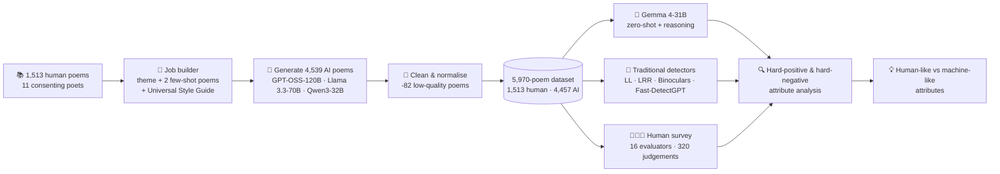

<div align="center">

# 🪶 Characterizing Human-Likeness in AI-Generated Poetry

### A Zero-Shot Classification Study

*Can a machine tell a machine's poem from a poet's? And what makes a poem "sound human"?*

[](https://www.python.org/)
[](https://doi.org/10.5281/zenodo.23205243)
[](https://doi.org/10.5281/zenodo.23205243)
[](https://academic.oup.com/dsh)
[](https://ai.google.dev/gemma)
[](#-reproduce-it-for-about-11)

**Angshu Nirmegh Biswas · Taspiha Tabassum · Afia Abida Shohid · Razia Marzan Mou · Ayeeshah Akter Esha · Farig Yousuf Sadeque · Anika Ahmed**

*Department of Computer Science and Engineering, BRAC University, Dhaka, Bangladesh*

</div>

---

## ✨ Why this project?

AI chatbots now write poems that are fluent, figurative and emotionally convincing. Earlier work suggests readers cannot reliably tell them apart from human poetry, and statistical detectors built on perplexity or log-probability struggle because a poem is *already* high in perplexity before any AI is involved.

We test that claim head-on and ask a more useful question: **which concrete attributes make a machine poem read as human, and which make a human poem read as machine?**

Instead of a closed, commercial detector, we use an **open, zero-shot pipeline** built on an open-weight LLM, then open up its reasoning to see *why* it is right or wrong.

## 🔑 Headline results

| | |
|---|---|
| 🏆 **Gemma 4-31B (zero-shot)** | **0.900 accuracy**, weighted F1 **0.900** on 5,970 poems |
| 🧑‍🏫 **Human evaluators** | **0.450 accuracy**, worse than a coin flip on the human poems (57.5% of human poems were called AI) |
| 🥷 **Hardest generator to catch** | **Qwen3-32B**, responsible for 254 of Gemma's 299 missed AI poems |
| 📉 **Surprise** | Fast-DetectGPT was the *weakest* traditional detector (weighted F1 0.552) |
| 🎭 **Biggest tell** | *Literary devices* (metaphor and imagery) carried the most weight in both correct and incorrect decisions |
| 💸 **Total compute cost** | **US$10.70** |

<details>
<summary><b>📊 Detector comparison (click to expand)</b></summary>

| Detector | Type | Accuracy | AI F1 | Human F1 | Weighted F1 |
|---|---|:---:|:---:|:---:|:---:|
| **Gemma 4-31B** | Zero-shot LLM | **0.900** | 0.933 | 0.802 | **0.900** |
| Log-Likelihood | Statistical | 0.865 | 0.909 | 0.734 | 0.865 |
| Log-Rank Ratio (LRR) | Statistical | 0.799 | 0.862 | 0.627 | 0.802 |
| Binoculars | Statistical | 0.585 | 0.652 | 0.485 | 0.610 |
| Fast-DetectGPT | Statistical | 0.523 | 0.599 | 0.412 | 0.552 |
| Human panel (16 evaluators) | Survey | 0.450 | 0.556 | 0.279 | 0.486 |

</details>

<details>
<summary><b>🥷 Which generator evades Gemma 4 most?</b></summary>

| Generator | AI poems missed (false negatives) | Share of its 1,513 poems |
|---|:---:|:---:|
| Qwen3-32B | 254 | 16.8% |
| GPT-OSS-120B | 40 | 2.6% |
| Llama 3.3-70B | 5 | 0.3% |

Qwen3-32B also had the richest vocabulary of the three models (highest type-token ratio) and the largest share of human vocabulary covered (42.68%).

</details>

## 🧭 Pipeline at a glance



## 🗂️ Dataset

| Source | Poems |
|---|---:|
| Human-authored (11 poets, all with permission) | 1,513 |
| GPT-OSS-120B (few-shot) | 1,513 |
| Llama 3.3-70B (few-shot) | 1,513 |
| Qwen3-32B (few-shot) | 1,513 |
| Removed during cleaning (poor quality) | −82 |
| **Final dataset** | **5,970** |

- **Style transfer by example.** Every human poem served as a style reference: each generation job pairs the poet's two randomly sampled poems with one of **20 traditional themes** (Love, Heartbreak, Mortality, Wonder, Resilience and more).
- **Contamination check.** Gemma 4 was asked to continue random lines from the human poems; none were reproduced, so no author was dropped.
- **Cleaning.** Chain-of-thought blocks, code fences, meta commentary, em dashes and non-English tokens were stripped from AI outputs.

📥 **Download the data:** [`doi.org/10.5281/zenodo.23205243`](https://doi.org/10.5281/zenodo.23205243)

## 🔬 What we found

**Gemma's reasoning tells us what gives a poem away.**

| Poem type | Most common reason Gemma gave |
|---|---|
| AI poem, **correctly caught** | Rigid, predictable rhyme scheme (36.7%) |
| Human poem, **correctly recognised** | Non-standard grammar, spelling and text-speak (47.0%) |
| AI poem that **slipped through** (Qwen3-32B) | Specific, grounded, visceral imagery (24.8%) |
| AI poem that **slipped through** (Llama / GPT-OSS) | Non-standard grammar, spelling and text-speak (80.0% / 62.5%) |
| Human poem **wrongly flagged** | Rigid, predictable rhyme (30.1%) and generic, clichéd metaphors (26.8%) |

**Other takeaways**

- 🔁 **Few-shot bias.** The models leaned on the example poems more than on the assigned theme (especially Llama), even overriding the "no em dashes" instruction.
- 🧬 **Shared words, different phrases.** AI and human poems overlap heavily at the word level (55% of human vocabulary) but barely at bigram (13%) and trigram (under 1%) level.
- 🤝 **Humans disagree with each other.** Paired evaluators gave identical verdicts on only 35.71% of poems, and criterion-level agreement was as low as 20.71% (grammar).
- ⚖️ **It cuts both ways.** Clichéd, rhyme-bound *human* poems get mistaken for AI, and imperfect, colloquial *AI* poems get mistaken for human.

## 📁 Repository layout

> ⚠️ **TODO before publishing:** this tree is a suggested layout. Adjust folder and file names so they match the actual contents of `code/`.

```text
CHLAI-OUP/
├── code/
│   ├── generation/        # job queue, few-shot prompt builder, LLM generation loop
│   ├── preprocessing/     # cleaning pipeline for raw AI outputs
│   ├── analysis/          # TTR, n-grams, TF-IDF, theme leakage, vocabulary overlap
│   ├── classification/    # Gemma 4 zero-shot pipeline + contamination test
│   ├── detectors/         # Log-Likelihood, LRR, Binoculars, Fast-DetectGPT
│   └── survey/            # human-evaluation analysis (agreement, confusion matrix)
├── data/                  # see Zenodo for the full dataset
├── figures/
├── requirements.txt
└── README.md
```

## ⚙️ Getting started

### 1. Clone and install

```bash
git clone https://github.com/angshubiswas22/CHLAI-OUP.git
cd CHLAI-OUP

python -m venv .venv
source .venv/bin/activate        # Windows: .venv\Scripts\activate
pip install -r requirements.txt
```

### 2. Add your API keys

Poem generation uses **GroqCloud** (free tier) and zero-shot classification uses **OpenRouter**. Create a `.env` file in the project root:

```bash
GROQ_API_KEY=your_groq_key_here
OPENROUTER_API_KEY=your_openrouter_key_here
```

> 🔒 Never commit `.env`. Add it to your `.gitignore`.

### 3. Get the dataset

Download the dataset from [Zenodo](https://doi.org/10.5281/zenodo.23205243) and place it in `data/`.

### 4. Run the pipeline

The stages run in this order. Resume logic is built in, so an interrupted run picks up where it stopped.

```bash
# 1. Generate AI poems (job queue with resume logic)
python code/generation/<generate_script>.py

# 2. Clean and normalise raw outputs
python code/preprocessing/<clean_script>.py

# 3. Lexical and semantic analysis
python code/analysis/<analysis_script>.py

# 4. Contamination test, then Gemma 4 zero-shot classification
python code/classification/<contamination_test>.py
python code/classification/<gemma_classify>.py

# 5. Traditional detectors (GPU recommended)
python code/detectors/<detector_script>.py
```

> ⚠️ **TODO:** replace each `<placeholder>` with the real script or notebook name.

## 💸 Reproduce it for about $11

| Resource | Purpose | Cost (USD) |
|---|---|---:|
| OpenRouter | Zero-shot classification (Gemma 4-31B) | 0.70 |
| GroqCloud SDK | Poem generation (free tier) | 0.00 |
| Colab Pro | Traditional detectors (GPU) | 10.00 |
| **Total** | | **10.70** |

## 🧪 Models used

| Model | Role | Access |
|---|---|---|
| GPT-OSS-120B | Poem generator | GroqCloud |
| Llama 3.3-70B | Poem generator | GroqCloud |
| Qwen3-32B | Poem generator | GroqCloud |
| Gemma 4-31B | Zero-shot classifier | OpenRouter |

## 🛣️ What's next

- Fine-tune Gemma 4-31B on **hard-negative examples** (poems with misleading attributes) to see how little data is needed.
- Investigate Qwen3-32B's high evasiveness with additional detectors.
- Collect an overall human label alongside the five criteria, and recruit native English speakers.

## ⚠️ Limitations

- Some ambiguity may remain in the dataset despite cleaning.
- The Universal Style Guide had uneven influence (for example, models still produced em dashes that had to be removed in preprocessing).
- No paraphrasers or "humanizers" were applied, because they would damage poetic structure. Results apply to **unaltered** AI poems.
- The survey panel was small (16 evaluators) and did not specifically recruit native English speakers.

## ⚖️ Ethics and data use

- All eleven poets gave permission for their poems to be used. **Poems remain the intellectual property of their authors**; please respect the terms on the Zenodo record and do not redistribute them separately.
- Survey participants consented, and identifying information was used only for progress tracking and was never published.
- This work is for **research on detection and attribution**. It should not be used as the sole basis for accusing a student or writer of misconduct: the human-authored poems in our data were wrongly flagged as AI about one time in five.

## 📖 Citation

If this work helps your research, please cite the dataset and manuscript:

```bibtex
@misc{biswas2026humanlikeness,
  title     = {Characterizing Human-Likeness in {AI}-Generated Poetry: A Zero-Shot Classification Study},
  author    = {Biswas, Angshu Nirmegh and Tabassum, Taspiha and Shohid, Afia Abida and Mou, Razia Marzan and Esha, Ayeeshah Akter and Sadeque, Farig Yousuf and Ahmed, Anika},
  year      = {2026},
  publisher = {Zenodo},
  doi       = {10.5281/zenodo.23205243},
  url       = {https://doi.org/10.5281/zenodo.23205243},
  note      = {Manuscript prepared for \emph{Digital Scholarship in the Humanities}}
}
```

> Once the paper is published, replace this entry with the final journal citation.

## 📬 Contact

**Corresponding author:** Angshu Nirmegh Biswas, [angshu.nirmegh.biswas@g.bracu.ac.bd](mailto:angshu.nirmegh.biswas@g.bracu.ac.bd)

Supervisors: [Farig Yousuf Sadeque](mailto:farig.sadeque@bracu.ac.bd) · [Anika Ahmed](mailto:anika.ahmed@bracu.ac.bd)

Found a bug or have an idea? Please [open an issue](../../issues). Collaboration on new human-like attributes is very welcome.

## 📜 License

> **TODO:** add a `LICENSE` file for the code (for example MIT or Apache-2.0) and state it here. The dataset's license is set on its [Zenodo record](https://doi.org/10.5281/zenodo.23205243).

## 🙏 Acknowledgements

We thank the poets, faculty members and survey respondents whose contributions made this dataset and evaluation possible.

<div align="center">

⭐ **If you find this project interesting, consider giving it a star!** ⭐

</div>
